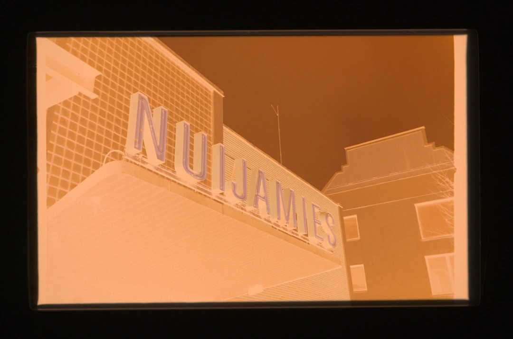
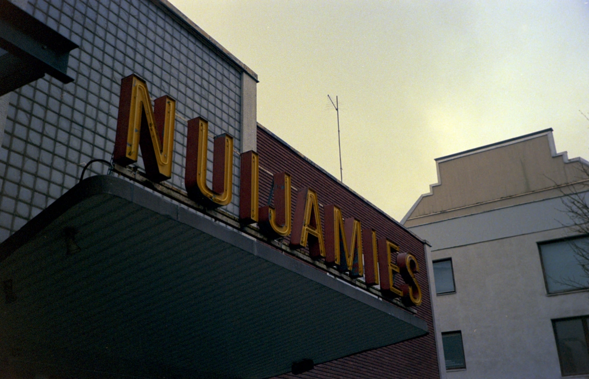
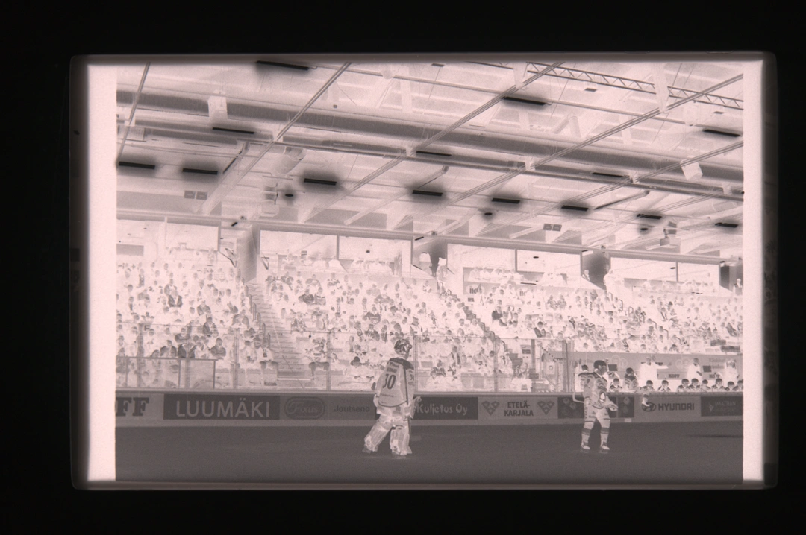
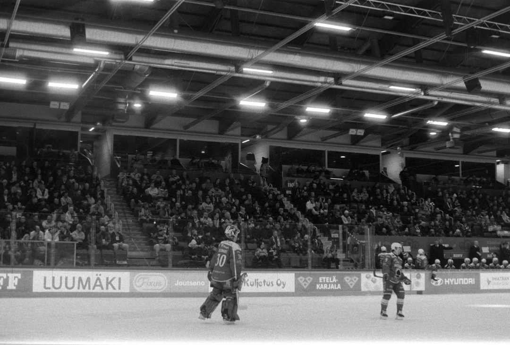
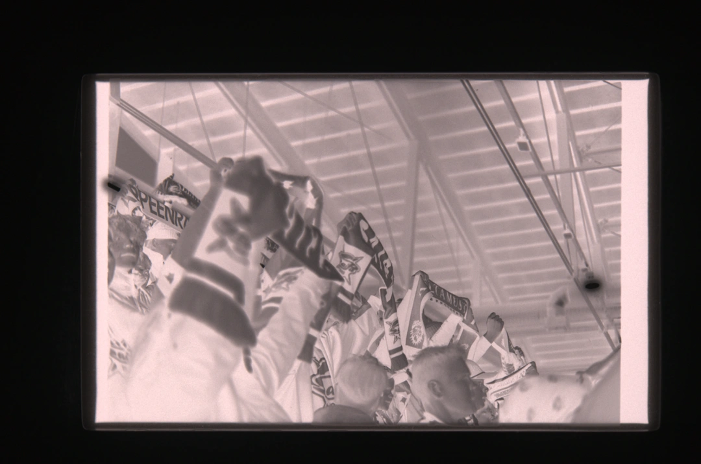
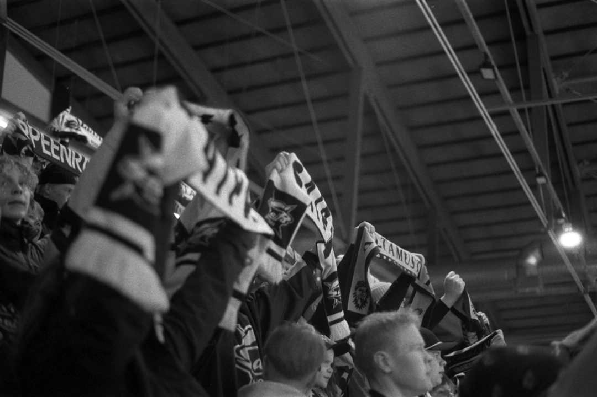
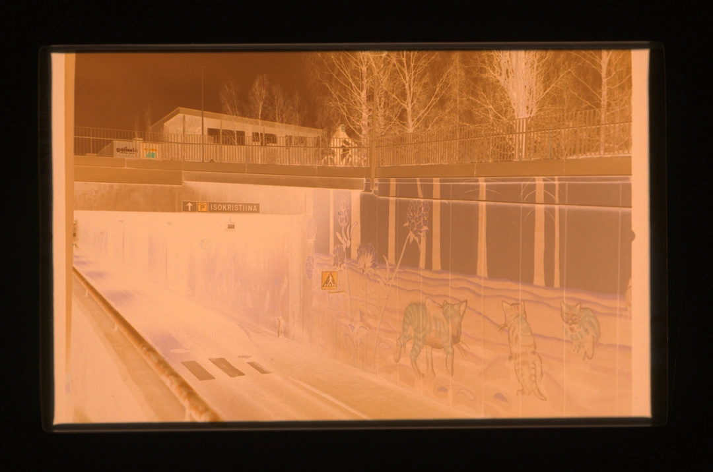
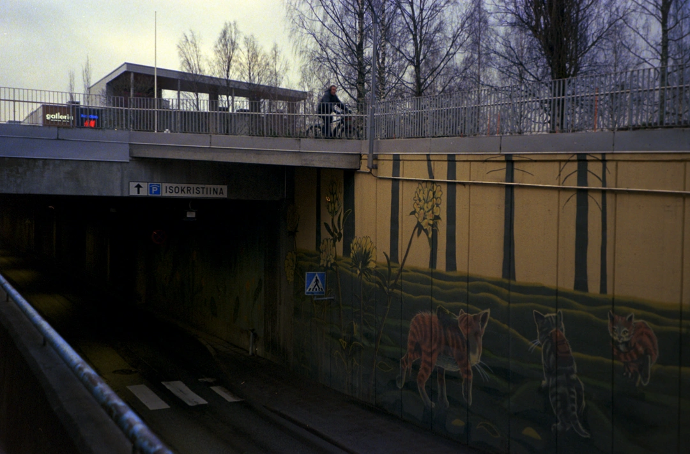

<p align="center">
  
</p>

<h1 align="center">eNegmatic</h1>
<br>
<p align="center"><i>made by Rtx9 &amp; Claude</i></p>
So yea "another vibe coded ai slop app", this one differs in the way that i actually have experience with it and gonna have my local photo store test it out in a real enviroment.
This free, open-source "alternative to some others" desktop app converts scanned **colour and B&W film negatives** into positives. Tested on scans from a Nikon Z7.
<br><br><br>

Below are some scans and the converted images i got (screenshots so quality sucks)
<br>







<br><br>

## Download

Get the latest version from the **[Releases](../../releases)** page. No installation of Python or anything else is needed.

### Windows
Download `eNegmatic-…-windows.zip`, unzip it anywhere and run `eNegmatic.exe`.

The app isn't code-signed, so the first launch may show *"Windows protected your PC"*.
Click **More info → Run anyway**.

### macOS (12 Monterey or newer)
Download the `.dmg` for your Mac:
- `eNegmatic-…-macos-arm64.dmg` for Apple Silicon (M1, M2, M3, M4…)
- `eNegmatic-…-macos-intel.dmg` for Intel Macs

Not sure which you have? Open the Apple menu → *About This Mac* and look at *Chip* (Apple) or *Processor* (Intel).

Open the `.dmg` and drag **eNegmatic** into **Applications**.

The app isn't notarized by Apple, so macOS blocks it on first launch. To open it anyway:
1. Double-click eNegmatic, then click **Done** (or **OK**) on the warning.
2. Open **System Settings → Privacy & Security**, scroll down, and click **Open Anyway** next to the eNegmatic message.
3. Confirm with **Open** (and your password if asked).

You only do this once. If macOS instead says the app *"is damaged"*, run this in Terminal once and open it again:
```
xattr -dr com.apple.quarantine /Applications/eNegmatic.app
```

## Run from source

Windows: double-click **`run.bat`**. macOS / Linux: run **`./run.sh`**.
On first run they create `.venv` and install the dependencies (Python 3.10 or newer).

Or manually:

```
python -m venv .venv
.venv\Scripts\python -m pip install -r requirements.txt     (macOS / Linux: .venv/bin/python …)
.venv\Scripts\python main.py            # optionally: main.py <files or folders>
```

## Build the app yourself

- **Windows:** double-click **`build.bat`** → `dist\eNegmatic\eNegmatic.exe` and `dist\eNegmatic-windows.zip`.
- **macOS:** run **`./build.sh`** → `dist/eNegmatic.app` and `dist/eNegmatic-macos.dmg`.

Each platform has to be built on that platform.

Releases are built automatically. Pushing a version tag (for example `v1.1.0`) runs the GitHub Actions
workflow in `.github/workflows/build.yml`. It builds on Windows, Apple Silicon and Intel Macs, self-tests
each build, and attaches all three downloads to the Release.

## Features

- **Automatic inversion.** The orange mask is removed and channels balanced per frame (auto levels + auto white balance).
- **Auto brightness.** Dim conversions (often caused by a few lamps or reflections setting the white point) are brightened like a gentle exposure push: highlights come up toward white without clipping, blacks stay black and night frames stay dark. Can be switched off per frame.
- **B&W prints with snap.** Black-and-white film is printed onto a slightly harder virtual paper grade than colour, for deeper blacks and cleaner whites.
- **Dust & hair removal (beta).** *Auto remove dust* (off whenever a frame is opened) finds dust specks and hairs on smooth areas (sky, walls, skin) and fills them in from their surroundings, grain included; on colour film it learns the scan's dust colour signature, so small coloured lights are left alone. The *healing brush* (H) paints out anything else; right-click undoes a spot or tells auto removal to keep a speck. Spots stay put when you rotate, flip or re-crop.
- **Colour and B&W modes, detected automatically.** Each new frame is classified on load. B&W silver puts all three channels on one line in density space, while colour dyes spread out; the orange mask is a second check. Click either button to override. B&W is processed as a single channel and can be exported as true grayscale.
- **Auto crop.** Finds the picture edges inside the rebate, the gaps between frames and the holder, and straightens tilt up to ±4°.
  It looks for straight, frame-length edges with frame border (clear film, holder or light) beyond them, so straight lines inside the picture, such as horizons, roof lines or a flat sky, aren't mistaken for the frame edge. Works for colour and B&W, 35 mm and medium format, and night scenes.
  Straightening traces the frame edges to a fraction of a pixel and balances opposite edges, so frames that aren't perfect rectangles (keystoning, film curl) come out as level as possible.
  It also recognises the format (3:2, 4:3, 5:4, 1:1, 6×7, 16:9, 65:24; 3:2 when unsure) and crops to it exactly.
  New images are auto-cropped when they load (switch this off under *Options*).
- **Manual crop tool.** Drag handles, rule-of-thirds overlay and aspect locks; each frame remembers its format.
  Drag just outside a corner to rotate. Straightening turns the picture about the crop centre and trims the crop
  just enough to keep empty corners out. Also: 90° rotate and flip.
- **Pickers.** *Film base* (click the clear film between frames for the most accurate colour) and *Pick neutral*
  (click something grey to set white balance).
- **Adjustments.** Exposure, contrast, midtones, highlights, shadows, black and white points,
  temperature, tint, saturation, sharpening and noise reduction (removes digital scan noise, keeps film grain).
  Double-click any slider to reset it. Every edit can be undone (Ctrl+Z) and redone (Ctrl+Shift+Z / Ctrl+Y).
- **Zoom.** Click the image to toggle fit and 1:1, or use mouse wheel or touchpad pinch to zoom; drag or two-finger scroll to pan.
  Past the preview's resolution, the full-resolution raw is decoded in the background and only the visible area is rendered sharply.
- **Live histogram** and a *Negative* toggle (**B**) for before/after.
- **Copy / Paste / Paste to all** settings between frames.
  The ⋯ button next to Copy chooses which groups get copied: film and inversion, tone, colour, detail, rotation, crop.
  *Lock analysis* freezes one frame's base and levels, so a whole roll converts consistently.
- **Export** the current, selected or all frames as JPEG, TIFF or PNG (8/16-bit), in **sRGB** (default), **Display P3**, **Adobe RGB** (compatible) or **ProPhoto RGB**.
  Every file gets an embedded ICC profile, so colour-managed apps display it correctly.
  You can resize, add a suffix, and choose the destination; exports run in parallel and can be cancelled.
- **Collapsible panel sections**, each with its own reset button, remembered between sessions.
- **Dark / light / system theme** (**Ctrl+T**).
- **Edits are saved automatically** in a small `.enegmatic.json` next to your images and restored when you reopen them.

## Suggested workflow for a roll

1. *Open Folder…* with the roll's raws/jpegs (whatever the bullshit your scanner/camera spits out). Frames auto-crop as previews build.
2. Pick *Colour negative* or *B&W negative*.
3. Get one representative frame right. Pick the film base if the border is visible, then adjust.
4. Optional: tick **Lock analysis (roll)** for consistent colour across frames.
5. **Copy**, then **Paste to all**. Fix any odd frames, then **Export All…**.

## Shortcuts

On macOS use **Cmd** wherever it says Ctrl.

| Key | Action |
|---|---|
| ← / → | Previous / next frame (click the image first) |
| Click / Z | Zoom 1:1 ↔ fit |
| Wheel, pinch, Ctrl+= / Ctrl+- | Zoom in / out |
| Ctrl+0 | Fit to window |
| C | Crop tool (Enter applies, Esc cancels; drag outside a corner to rotate) |
| A | Auto crop |
| B | Show the original negative |
| [ / ] | Rotate left / right |
| Shift+F | Flip |
| Ctrl+Z / Ctrl+Shift+Z | Undo / redo |
| Ctrl+Shift+C / V | Copy / paste settings |
| Ctrl+Alt+C | Choose what to copy |
| Ctrl+R | Reset adjustments |
| Ctrl+E / Ctrl+Shift+E | Export current / export all |

## How it works

Raw files are decoded linearly with a fixed daylight white balance, so frames stay consistent regardless of camera
AWB. The negative is converted to **density** (−log10 of transmittance). Each channel is then normalised between its
film-base density and its densest point, which removes the orange mask. Optional grey-pixel balancing follows.
Density is mapped back to light with an exponential "print" curve, and the tone and colour adjustments are applied.
Every per-channel step is baked into one lookup table, which keeps the preview fast.

The preview and the export share the same stored analysis, so exported files match what you see.

## Files

- `main.py` is the entry point; it shows the splash screen while the app loads.
- `enegmatic/splash.py` draws the splash screen and app icon in Century Gothic (ships with Windows / Office), falling back to the bundled Comfortaa font (`enegmatic/assets`, SIL Open Font License).
- `enegmatic/core.py` holds the conversion pipeline (no Qt).
- `enegmatic/autocrop.py` does frame detection and straightening.
- `enegmatic/fileio.py` covers raw and bitmap loading, saving, and the sidecar files.
- `enegmatic/batch.py` runs full-resolution export in worker processes.
- `enegmatic/mainwindow.py`, `widgets.py`, `export.py` and `theme.py` make up the UI.
- `packaging/` holds the PyInstaller spec (Windows `.exe` and macOS `.app`) and the Windows file-version info; `build.bat` / `build.sh` run it.
- `tools/make_icon.py` regenerates the Windows `.ico`, the macOS `.icns` and the logo PNG in `enegmatic/assets`.

## Notes

- Full-resolution exports use roughly 1–2 GB of RAM per parallel job for 45 MP raws.
  Lower *Parallel jobs* in the export dialog if memory is tight.
- Auto crop needs some visible border (film base, gap, holder or light). For pre-cropped scans it leaves the frame alone.
  It leaves a 1 % safety inset, which you can change under *Options ▸ Auto-crop Inset*.

## License

eNegmatic is free software, released under the **GNU General Public License v3.0** (see [LICENSE](LICENSE)).
You may use, study, share and modify it. If you distribute a modified version, it must also be released under the GPL v3.0, with its source code.

Bundled third-party components keep their own licences; see [THIRD-PARTY-NOTICES.md](THIRD-PARTY-NOTICES.md).
